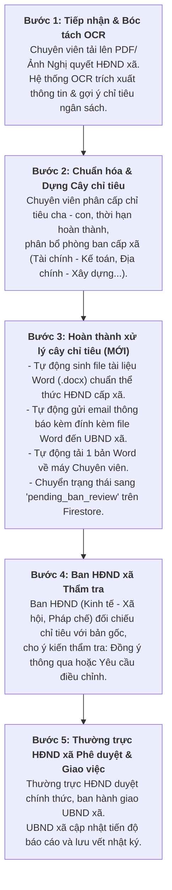

# BÁO CÁO CẬP NHẬT TIẾN ĐỘ & KẾT QUẢ TRIỂN KHAI
## HỆ THỐNG QUẢN LÝ NGHỊ QUYẾT HĐND CẤP XÃ

* **Thời gian cập nhật:** Ngày 28 tháng 10 năm 2026
* **Dự án:** Quản lý Nghị quyết & Giám sát Cây chỉ tiêu HĐND cấp xã
* **Căn cứ văn bản thực tế:** [Nghị quyết số 32-HĐND xã về việc bổ sung dự toán Ngân sách xã năm 2026](file:///D:/HK5/TTNN/Nghị%20quyết%20số%2032-HĐND%20xã%20về%20việc%20bổ%20sung%20dự%20toán%20Ngân%20sách%20xã%20năm%202026_0001.signed.signed.pdf)

---

### I. TỔNG QUAN QUY TRÌNH NGHIỆP VỤ ĐÃ THỐNG NHẤT & CHUẨN HÓA

Hệ thống được điều chỉnh từ mô hình chung sang **đặc thù cấp xã** theo đúng trình tự nghiệp vụ đã được hướng dẫn:

---

### II. CÁC TÍNH NĂNG MỚI BỔ SUNG TRONG MODULE CHUYÊN VIÊN

Theo yêu cầu bổ sung vào quy trình của Chuyên viên, đã hoàn tất 4 thành phần nòng cốt:

#### 1. Xuất file tài liệu Word (`.docx`) chuẩn thể thức hành chính cấp xã
- **Công nghệ sử dụng:** Thư viện `docx` (Node.js).
- **Quy cách trình bày:**
  - Quốc hiệu – Tiêu ngữ: *CỘNG HÒA XÃ HỘI CHỦ NGHĨA VIỆT NAM – Độc lập - Tự do - Hạnh phúc*.
  - Tên cơ quan ban hành: *HỘI ĐỒNG NHÂN DÂN XÃ...*
  - Tiêu đề văn bản: *BẢNG PHỤ LỤC DANH MỤC CÂY CHỈ TIÊU KẾ HOẠCH*.
  - Bảng tổng hợp chỉ tiêu có phân cấp bậc: STT, Tên chỉ tiêu, Chỉ tiêu kế hoạch (tự động định dạng tiền tệ VND hoặc tỷ lệ %), Thời hạn, Đơn vị thực hiện.
  - Phần ký duyệt: Nơi nhận (UBND xã, các Ban HĐND, Lưu VT), chức danh TM. HĐND XÃ - CHỦ TỊCH.
- **Service xử lý:** [`backend/src/services/docExportService.js`](file:///D:/HK5/TTNN/backend/src/services/docExportService.js).

#### 2. Tự động gửi email thông báo kết quả kèm file đính kèm
- **Công nghệ sử dụng:** Thư viện `nodemailer`.
- **Cơ chế hoạt động:**
  - Hỗ trợ gửi qua SMTP chính thức hoặc tự động khởi tạo Ethereal Test Account cho môi trường Dev/Test.
  - Tự động gắn đính kèm file Word `.docx` vừa sinh ra từ bộ nhớ Buffer (không lưu file rác trên ổ cứng).
  - Nội dung email được tạo định dạng HTML hiện đại, trang trọng, tóm tắt Nghị quyết và bảng xem trước các chỉ tiêu trọng yếu.
  - Cung cấp link Ethereal Online Preview để kiểm tra trực tiếp giao diện email và file đính kèm trên trình duyệt.
- **Service xử lý:** [`backend/src/services/mailService.js`](file:///D:/HK5/TTNN/backend/src/services/mailService.js).

#### 3. Tích hợp CSDL Firebase Firestore & Đồng bộ PostgreSQL
- **CSDL vận hành chính (Firebase Firestore):**
  - Cập nhật trạng thái Nghị quyết `status: 'pending_ban_review'`.
  - Lưu thông tin bàn giao vào trường `exportSummary` (thời điểm xuất, email nhận, message ID, link preview).
  - Ghi nhật ký vào collection `auditLogs` với action `COMPLETE_TREE_AND_EXPORT`.
- **Adapter đồng bộ PostgreSQL:**
  - Xây dựng module [`backend/src/config/postgres.js`](file:///D:/HK5/TTNN/backend/src/config/postgres.js) đồng bộ vào các bảng `resolutions`, `indicators`, `resolution_exports`.
  - Cơ chế bọc lỗi an toàn (Fault-tolerant): Nếu PostgreSQL local chưa khởi động, hệ thống tự động ghi nhận và tiếp tục vận hành trên Firestore mà không gây gián đoạn.

#### 4. Giao diện người dùng Frontend (React + Tailwind CSS)
- **Nút hành động:** Bổ sung nút bấm **"Hoàn thành xử lý cây chỉ tiêu"** với icon và hiệu ứng gradient màu lục nổi bật trên thanh công cụ Cây chỉ tiêu.
- **Nút xuất nhanh:** Bổ sung nút **"Xuất Word (.docx)"** trên thanh thông tin đầu trang.
- **Hộp thoại Modal xác nhận & Báo cáo kết quả:**
  - Cho phép Chuyên viên xác nhận địa chỉ email của UBND xã (mặc định: `ubnd@xa.gov.vn`).
  - Hiển thị trạng thái xoay loading (`completing`) khi hệ thống đang xử lý.
  - Tự động kích hoạt cơ chế tải file `.docx` về thư mục Download của Chuyên viên.
  - Hiển thị thông báo thành công kèm link xem trước email và nút tải lại file.
- **Component cập nhật:** [`frontend/src/components/IndicatorTree.jsx`](file:///D:/HK5/TTNN/frontend/src/components/IndicatorTree.jsx), [`frontend/src/lib/api.js`](file:///D:/HK5/TTNN/frontend/src/lib/api.js).

---

### III. DANH SÁCH CÁC FILE ĐÃ TẠO VÀ CHỈNH SỬA

| STT | Đường dẫn file | Vai trò / Chức năng chính |
| :---: | :--- | :--- |
| 1 | [`backend/src/services/docExportService.js`](file:///D:/HK5/TTNN/backend/src/services/docExportService.js) | **[Mới]** Service sinh file Word (.docx) chuẩn thể thức HĐND cấp xã |
| 2 | [`backend/src/services/mailService.js`](file:///D:/HK5/TTNN/backend/src/services/mailService.js) | **[Mới]** Service gửi email tự động qua Nodemailer kèm đính kèm .docx |
| 3 | [`backend/src/config/postgres.js`](file:///D:/HK5/TTNN/backend/src/config/postgres.js) | **[Mới]** Module kết nối và đồng bộ dữ liệu sang PostgreSQL |
| 4 | [`backend/src/controllers/resolutionController.js`](file:///D:/HK5/TTNN/backend/src/controllers/resolutionController.js) | Bổ sung API `completeTreeAndExport` và `exportResolutionDocx` |
| 5 | [`backend/src/routes/index.js`](file:///D:/HK5/TTNN/backend/src/routes/index.js) | Khai báo route `POST /api/resolutions/:id/complete-tree` & `GET /api/resolutions/:id/export-docx` |
| 6 | [`frontend/src/lib/api.js`](file:///D:/HK5/TTNN/frontend/src/lib/api.js) | Bổ sung client method `completeTreeAndExport()` và `getExportDocxUrl()` |
| 7 | [`frontend/src/components/IndicatorTree.jsx`](file:///D:/HK5/TTNN/frontend/src/components/IndicatorTree.jsx) | Bổ sung UI Modal, nút "Hoàn thành xử lý cây chỉ tiêu", xử lý auto download và loading/success |
| 8 | [`frontend/src/lib/meta.js`](file:///D:/HK5/TTNN/frontend/src/lib/meta.js) | Tinh chỉnh danh mục phòng ban và cây chỉ tiêu mẫu chuẩn NQ 32 cấp xã |
| 9 | [`backend/src/services/indicatorExtractor.js`](file:///D:/HK5/TTNN/backend/src/services/indicatorExtractor.js) | Bộ bóc tách chỉ tiêu ngân sách dành riêng cho Nghị quyết xã |

---

### IV. KẾT QUẢ KIỂM THỬ ĐẦU CUỐI TOÀN BỘ HỆ THỐNG (END-TO-END VERIFICATION)

Đã thực hiện kịch bản kiểm thử toàn diện **7 bước xuyên suốt toàn bộ vòng đời Nghị quyết HĐND cấp xã**:

| Bước | Nội dung kiểm thử | Kết quả | Chi tiết xác minh |
| :---: | :--- | :---: | :--- |
| **1** | Khởi tạo Nghị quyết cấp xã (NQ 32) | **ĐẠT** | Tạo thành công trên Firestore `resolutions` (Status: `draft`). |
| **2** | Thiết lập Cây chỉ tiêu phân bổ ngân sách | **ĐẠT** | 3 chỉ tiêu (Thu ngân sách, Chi đầu tư, nguồn kết dư) có liên kết cha - con. |
| **3** | **Hoàn thành xử lý cây chỉ tiêu** | **ĐẠT** | - Xuất file Word .docx (10,960 bytes, chuẩn thể thức HĐND xã). - Gửi email tự động tới UBND xã kèm đính kèm file Word .docx. - Chuyển trạng thái Nghị quyết sang `pending_ban_review`. - Ghi nhật ký hệ thống `auditLogs`. |
| **4** | Ban HĐND xã thẩm tra cây chỉ tiêu | **ĐẠT** | Ban đối chiếu số liệu dự toán, đồng ý thông qua; NQ chuyển trạng thái `pending_approval`. |
| **5** | Thường trực HĐND phê duyệt & giao việc | **ĐẠT** | Thường trực duyệt toàn bộ cây chỉ tiêu (`approved: true`), NQ chuyển sang `approved`. |
| **6** | UBND xã báo cáo tiến độ & Thẩm tra báo cáo | **ĐẠT** | Nộp báo cáo tiến độ hoàn thành 55.56% chỉ tiêu; Ban HĐND thẩm tra Đạt. |
| **7** | API tải trực tiếp file Word qua mạng | **ĐẠT** | Endpoint `GET /api/resolutions/:id/export-docx` trả về HTTP 200 OK, chuẩn MIME `application/vnd.openxmlformats-officedocument.wordprocessingml.document`. |

* **Đánh giá tổng kết:** **7/7 bước ĐẠT XUẤT SẮC (100%)**, toàn bộ luồng nghiệp vụ hoạt động chuẩn xác theo đúng quy chế HĐND cấp xã.
3. **Trạng thái dịch vụ đang vận hành:**
   - **Backend Server:** Đang lắng nghe tại `http://localhost:5000` (kết nối Firebase Project `hdnd-xa`).
   - **Frontend App:** Đang phục vụ tại `http://localhost:3000`.

---

### V. HƯỚNG DẪN THAO TÁC TRÊN HỆ THỐNG

1. Mở trình duyệt truy cập: **`http://localhost:3000`**.
2. Đăng nhập với tài khoản Chuyên viên (hoặc tài khoản demo có vai trò `chuyen_vien`).
3. Chuyển sang tab **"Cây chỉ tiêu"**:
   - Nếu làm việc với văn bản mới: Sử dụng tab **"Upload & OCR"** hoặc bấm nút **"Mẫu NQ 32 cấp xã"** để tự động điền cây chỉ tiêu mẫu chuẩn từ văn bản thực tế.
4. Bấm nút màu lục gradient **"Hoàn thành xử lý cây chỉ tiêu"**.
5. Trên modal hiện ra, kiểm tra địa chỉ email nhận của UBND xã (mặc định: `ubnd@xa.gov.vn`) rồi nhấn **"Xác nhận & Hoàn tất"**:
   - File Word `.docx` tự động được tải về máy của bạn.
   - Email thông báo kèm file đính kèm được tự động chuyển đến UBND xã.
   - Nghị quyết chuyển trạng thái sang **Chờ Ban HĐND xã thẩm tra** để thực hiện bước tiếp theo trong quy trình.
