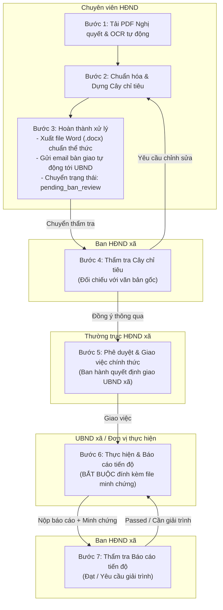

# CẨM NANG HƯỚNG DẪN SỬ DỤNG HỆ THỐNG HĐND SỐ CẤP XÃ

## Quản lý, Giám sát & Theo dõi thực hiện Nghị quyết HĐND cấp xã

---

## MỤC LỤC

1. [Tổng quan hệ thống & Triết lý vận hành](#1-tổng-quan-hệ-thống--triết-lý-vận-hành)
2. [Bảng phân quyền vai trò (RBAC) & Tài khoản mẫu](#2-bảng-phân-quyền-vai-trò-rbac--tài-khoản-mẫu)
3. [Sơ đồ phối hợp liên thông giữa các vai trò](#3-sơ-đồ-phối-hợp-liên-thông-giữa-các-vai-trò)
4. [Hướng dẫn chi tiết từng khâu theo từng Role](#4-hướng-dẫn-chi-tiết-từng-khâu-theo-từng-role)
   - [Khâu 1: Chuyên viên HĐND — Tiếp nhận, OCR & Dựng cây chỉ tiêu](#khâu-1-chuyên-viên-hđnd--tiếp-nhận-ocr--dựng-cây-chỉ-tiêu)
   - [Khâu 2: Ban HĐND — Thẩm tra sơ bộ Cây chỉ tiêu](#khâu-2-ban-hđnd--thẩm-tra-sơ-bộ-cây-chỉ-tiêu)
   - [Khâu 3: Thường trực HĐND — Phê duyệt chính thức & Giao việc](#khâu-3-thường-trực-hđnd--phê-duyệt-chính-thức--giao-việc)
   - [Khâu 4: UBND xã / Đơn vị thực hiện — Cập nhật tiến độ & Minh chứng](#khâu-4-ubnd-xã--đơn-vị-thực-hiện--cập-nhật-tiến-độ--minh-chứng)
   - [Khâu 5: Ban HĐND — Thẩm tra Báo cáo tiến độ 2 chiều](#khâu-5-ban-hđnd--thẩm-tra-báo-cáo-tiến-độ-2-chiều)
   - [Khâu 6: Giám sát toàn diện trên Dashboard & Nhật ký Audit Log](#khâu-6-giám-sát-toàn-diện-trên-dashboard--nhật-ký-audit-log)
5. [Quy định về Tài liệu minh chứng & Thể thức văn bản](#5-quy-định-về-tài-liệu-minh-chứng--thể-thức-văn-bản)
6. [Xử lý các tình huống nghiệp vụ thường gặp](#6-xử-lý-các-tình-huống-nghiệp-vụ-thường-gặp)
7. [Hướng dẫn khởi động hệ thống](#7-hướng-dẫn-khởi-động-hệ-thống)

---

## 1. TỔNG QUAN HỆ THỐNG & TRIẾT LÝ VẬN HÀNH

Hệ thống được thiết kế đặc thù cho **Hội đồng nhân dân (HĐND) cấp xã/phường/thị trấn**, giải quyết bài toán quản lý phân tán trước đây:

- Nghị quyết không còn nằm im trong các tập hồ sơ giấy hay file PDF rời rạc.
- Toàn bộ chỉ tiêu kinh tế, ngân sách, hạ tầng được số hóa thành **Cây chỉ tiêu phân cấp (Cha – Con)**.
- Vận hành theo nguyên tắc **Cơ sở dữ liệu (CSDL) dùng chung**: _"Sản sinh dữ liệu một lần, chia sẻ sử dụng nhiều lần"_. Thông tin số hiệu, trích yếu, tên chỉ tiêu chỉ cần tạo một lần, các khâu sau tự động liên kết mà không phải gõ lại.
- **100% minh bạch pháp lý**: Báo cáo tiến độ bắt buộc phải kèm tài liệu minh chứng hợp lệ (hóa đơn, biên bản nghiệm thu, ảnh hiện trường...). Mọi thao tác ghi/sửa/duyệt đều tự động lưu vết vào sổ nhật ký kiểm toán không thể sửa xóa (**Audit Log**).

---

## 2. BẢNG PHÂN QUYỀN VAI TRÒ (RBAC) & TÀI KHOẢN MẪU

Hệ thống thiết lập 4 nhóm vai trò với thẩm quyền nghiệp vụ độc lập:

| Mã vai trò (Role)   | Tên chức danh                                            | Nhiệm vụ & Thẩm quyền chính                                                                                                                   | Tài khoản demo gợi ý   |
| :------------------ | :------------------------------------------------------- | :-------------------------------------------------------------------------------------------------------------------------------------------- | :--------------------- |
| `chuyen_vien`       | **Chuyên viên HĐND**                                     | Tải lên PDF, kiểm tra OCR bóc tách thông tin, dựng cây chỉ tiêu phân cấp, xuất file Word (.docx) chuẩn thể thức, gửi email bàn giao cho UBND. | `chuyenvien@xa.gov.vn` |
| `ban_hdnd`          | **Ban HĐND xã** _(Ban Kinh tế - Xã hội, Ban Pháp chế)_   | Thẩm tra đối chiếu cây chỉ tiêu với văn bản gốc; Thẩm tra tính xác thực của báo cáo tiến độ và tài liệu minh chứng do UBND nộp.               | `ban_hdnd@xa.gov.vn`   |
| `thuong_truc`       | **Thường trực HĐND** _(Chủ tịch / Phó Chủ tịch)_         | Ký duyệt chính thức cây chỉ tiêu và giao việc; Ấn định deadline và đơn vị chủ trì/phối hợp; Giám sát toàn bộ tiến độ cấp xã.                  | `thuongtruc@xa.gov.vn` |
| `co_quan_thuc_hien` | **Cơ quan thực hiện** _(UBND xã, Kế toán, Địa chính...)_ | Tiếp nhận nhiệm vụ được giao; Báo cáo tỷ lệ hoàn thành theo định kỳ; **Bắt buộc tải lên file minh chứng pháp lý**.                            | `ubnd@xa.gov.vn`       |

> _Ghi chú: Mật khẩu mặc định cho các tài khoản kiểm thử là: `123456`._

---

## 3. SƠ ĐỒ PHỐI HỢP LIÊN THÔNG GIỮA CÁC VAI TRÒ

Quy trình vòng đời Nghị quyết HĐND cấp xã được số hóa khép kín qua 6 bước:



---

## 4. HƯỚNG DẪN CHI TIẾT TỪNG KHÂU THEO TỪNG ROLE

### Khâu 1: Chuyên viên HĐND — Tiếp nhận, OCR & Dựng cây chỉ tiêu

- **Mục tiêu:** Đưa Nghị quyết từ giấy/PDF vào hệ thống số và bóc tách thành các hạng mục công việc cụ thể.
- **Giao diện làm việc:** Menu **"Upload & OCR"** và **"Cây chỉ tiêu"**.

#### Các bước thực hiện:

1. **Đăng nhập** bằng tài khoản Chuyên viên (`chuyenvien@xa.gov.vn`).
2. Vào tab **"Upload & OCR"**:
   - Kéo thả file PDF Nghị quyết (hoặc ảnh scan) vào khung tải lên. _(Có nút "Nạp file mẫu NQ 32" để thử nghiệm nhanh)_.
   - Bấm **"Tải lên & OCR tự động"**.
   - Hệ thống sẽ tự động hiển thị bản xem trước PDF bên trái và bóc tách các trường:
     - **Số hiệu:** Ví dụ `32/NQ-HĐND` hoặc `26/NQ-HĐND`.
     - **Ngày ban hành:** Định dạng ngày/tháng/năm.
     - **Trích yếu:** Tự động nhận diện nội dung nghị quyết (không bị lẫn với Quốc hiệu).
     - **Người ký:** Nhận diện Chủ tịch HĐND xã.
   - Nếu có sai sót nhỏ do bản scan mờ, Chuyên viên có thể chỉnh sửa trực tiếp rồi bấm **"Lưu cập nhật"**.
3. Chuyển sang tab **"Cây chỉ tiêu"**:
   - Hệ thống tự động điền các chỉ tiêu đã bóc tách từ văn bản.
   - Chuyên viên bổ sung/điều chỉnh cấu trúc:
     - Bấm **"+ Thêm chỉ tiêu"** để tạo chỉ tiêu gốc.
     - Bấm icon **↳ (Thêm con)** để phân cấp chỉ tiêu phụ (Ví dụ: Cha là _Tổng dự toán bổ sung_, Con là _Sửa chữa trường học_, _Thoát nước khu dân cư_...).
     - Nhập **Chỉ tiêu kế hoạch** (Số tiền VNĐ hoặc số lượng) và **Đơn vị tính** (`đồng`, `%`, `công trình`, `hộ`...).
     - Chọn **Đơn vị chủ trì thực hiện** (Bộ phận Kinh tế, Văn hóa - Xã hội, Tài chính - Kế toán...).
     - Đặt **Hạn hoàn thành (Deadline)** và **Chu kỳ báo cáo** (_Hàng tháng_, _Hàng quý_, _Hàng năm_).
4. **Hoàn thành xử lý & Bàn giao:**
   - Bấm nút **"Hoàn thành xử lý cây chỉ tiêu"** (nút màu xanh lục nổi bật):
     - Hộp thoại xác nhận hiển thị địa chỉ email của UBND xã (`ubnd@xa.gov.vn`).
     - Hệ thống **tự động sinh file Word (`.docx`)** chuẩn thể thức hành chính (font Times New Roman 13, tiêu đề 15, giãn dòng 1.5, lề chuẩn Nghị định 30).
     - Hệ thống **tự động gửi email kèm file Word** đến UBND xã.
     - Trình duyệt **tự động tải 1 bản Word** về máy của Chuyên viên.
     - Trạng thái Nghị quyết tự động chuyển sang: `pending_ban_review` _(Chờ Ban HĐND thẩm tra)_.

---

### Khâu 2: Ban HĐND — Thẩm tra sơ bộ Cây chỉ tiêu

- **Mục tiêu:** Các Ban của HĐND (Kinh tế - Xã hội, Pháp chế) đối chiếu cây chỉ tiêu do Chuyên viên dựng với văn bản Nghị quyết gốc trước khi trình Thường trực HĐND ký duyệt.
- **Giao diện làm việc:** Menu **"Cây chỉ tiêu"**.

#### Các bước thực hiện:

1. Đăng nhập bằng tài khoản Ban HĐND (`ban_hdnd@xa.gov.vn`).
2. Vào tab **"Cây chỉ tiêu"**, chọn Nghị quyết đang ở trạng thái `pending_ban_review`.
3. Phía bên trái màn hình là văn bản gốc (PDF), bên phải là Bảng danh mục chỉ tiêu. Thành viên Ban tiến hành đối chiếu:
   - Số liệu ngân sách phân bổ có khớp với số liệu trong văn bản hay không?
   - Các phòng ban được giao có đúng chức năng nhiệm vụ cấp xã hay không?
   - Thời hạn hoàn thành có khả thi không?
4. Kéo xuống khung **"Thẩm tra cây chỉ tiêu (Dành cho Ban HĐND)"**:
   - Nhập nhận xét/ý kiến thẩm tra vào ô văn bản.
   - **Nếu đồng ý:** Bấm nút **"Đồng ý thông qua (Chuyển Thường trực)"** $\rightarrow$ Nghị quyết chuyển sang `pending_approval`.
   - **Nếu có sai sót:** Bấm nút **"Yêu cầu chỉnh sửa"** $\rightarrow$ Nghị quyết chuyển về `revision_requested`, Chuyên viên sẽ nhận được thông báo kèm ý kiến để sửa lại.

---

### Khâu 3: Thường trực HĐND — Phê duyệt chính thức & Giao việc

- **Mục tiêu:** Thường trực HĐND (Chủ tịch / Phó Chủ tịch) thay mặt HĐND phê duyệt ban hành chỉ tiêu và chính thức giao quyền, trách nhiệm cho UBND xã thực hiện.
- **Giao diện làm việc:** Menu **"Phê duyệt & Giao việc"**.

#### Các bước thực hiện:

1. Đăng nhập bằng tài khoản Thường trực HĐND (`thuongtruc@xa.gov.vn`).
2. Vào tab **"Phê duyệt & Giao việc"**:
   - Chọn Nghị quyết đã được Ban HĐND thông qua (`pending_approval`).
   - Xem lại toàn bộ cây chỉ tiêu và ý kiến của Ban HĐND.
3. Thao tác phê duyệt:
   - Có thể bấm **"Duyệt & Giao việc"** cho từng chỉ tiêu riêng lẻ.
   - Hoặc bấm **"Duyệt toàn bộ cây chỉ tiêu"** trên thanh công cụ.
4. **Kết quả:** Các chỉ tiêu chuyển sang trạng thái đã phê duyệt (`approved: true`). Toàn bộ hệ thống sẵn sàng tiếp nhận báo cáo tiến độ từ các đơn vị được giao.

---

### Khâu 4: UBND xã / Đơn vị thực hiện — Cập nhật tiến độ & Minh chứng

- **Mục tiêu:** Đơn vị phụ trách định kỳ nộp số liệu thực tế kèm văn bản chứng minh tính xác thực.
- **Giao diện làm việc:** Menu **"Báo cáo tiến độ"**.

#### Các bước thực hiện:

1. Đăng nhập bằng tài khoản Đơn vị thực hiện (`ubnd@xa.gov.vn`).
2. Vào tab **"Báo cáo tiến độ"**:
   - **Chọn Nghị quyết** và **Chọn Chỉ tiêu** muốn báo cáo (ví dụ: _Hạng mục thoát nước ngập úng_ hoặc _Chi trả trợ cấp không chuyên trách_).
   - Hệ thống hiển thị sẵn: Mức kế hoạch, Đơn vị tính, Hạn hoàn thành, Đơn vị chủ trì.
3. Điền thông tin báo cáo:
   - **Số liệu thực hiện đến nay:** Nhập con số thực tế đã hoàn thành (Hệ thống tự động tính ra tỷ lệ `% hoàn thành`).
   - **Kỳ báo cáo:** Chọn _Tháng này_, _Quý này_, hoặc _Cả năm_.
   - **Thuyết minh tiến độ / Khó khăn vướng mắc:** Ghi rõ hiện trạng giải ngân, thi công hoặc lý do chậm trễ nếu có.
4. **Đính kèm tài liệu minh chứng (BẮT BUỘC 100%):**
   - Bấm chọn file tại mục **"Tệp minh chứng pháp lý"** (chấp nhận file PDF, hình ảnh chụp chứng từ, biên bản nghiệm thu, hóa đơn thanh toán kho bạc...).
     > _Lưu ý quan trọng: Nếu không đính kèm file minh chứng, hệ thống sẽ từ chối gửi báo cáo (báo lỗi 400) nhằm đảm bảo tính pháp lý._
5. Bấm **"Gửi báo cáo tiến độ"**. Báo cáo sẽ được chuyển đến các Ban HĐND để chờ thẩm tra.

---

### Khâu 5: Ban HĐND — Thẩm tra Báo cáo tiến độ 2 chiều

- **Mục tiêu:** HĐND thực hiện quyền năng giám sát thực tế: đối chiếu số liệu báo cáo của UBND với tài liệu minh chứng đính kèm.
- **Giao diện làm việc:** Menu **"Thẩm tra báo cáo"**.

#### Các bước thực hiện:

1. Đăng nhập bằng tài khoản Ban HĐND (`ban_hdnd@xa.gov.vn`) hoặc Thường trực.
2. Vào tab **"Thẩm tra báo cáo"**:
   - Chọn Báo cáo tiến độ cần kiểm tra từ danh sách chờ duyệt.
   - Hệ thống hiển thị song song:
     - Cột trái: Số liệu tự báo cáo của UBND xã, tỷ lệ %, nội dung giải trình.
     - Nút bấm **"Xem file minh chứng"**: Mở trực tiếp chứng từ scan/PDF do UBND gửi lên để kiểm tra số liệu thực tế.
3. Kết luận thẩm tra:
   - Nhập ý kiến nhận xét của Ban (ghi rõ đồng ý hoặc lý do không công nhận).
   - **Đánh giá ĐẠT (`passed`):** Bấm **"Công nhận kết quả (Passed)"** $\rightarrow$ Số liệu chính thức được ghi nhận vào tiến độ chung của toàn xã.
   - **Yêu cầu giải trình (`need_clarification`):** Bấm **"Yêu cầu giải trình / Nộp lại"** $\rightarrow$ Báo cáo bị trả về, UBND xã phải nộp lại số liệu hoặc bổ sung minh chứng rõ ràng hơn.

---

### Khâu 6: Giám sát toàn diện trên Dashboard & Nhật ký Audit Log

- **Mục tiêu:** Mọi đại biểu HĐND, lãnh đạo UBND nắm bắt bức tranh tổng thể theo thời gian thực.
- **Giao diện làm việc:** Menu **"Tổng quan (Dashboard)"**.

#### Các tính năng giám sát:

1. **Thẻ thống kê tổng hợp:**
   - Tổng số Nghị quyết, Tổng số chỉ tiêu đang theo dõi, Tỷ lệ hoàn thành bình quân toàn xã.
2. **Hệ thống đèn cảnh báo Deadline tự động (Cron job quét hàng đêm):**
   - 🟢 **Màu xanh lá:** Chỉ tiêu còn nhiều thời gian (> 7 ngày).
   - 🟡 **Màu vàng cảnh báo:** Còn $\le 7$ ngày là đến hạn hoàn thành $\rightarrow$ Cần đôn đốc khẩn trương.
   - 🔴 **Màu đỏ báo động:** Đã quá hạn deadline mà chưa hoàn thành $\rightarrow$ HĐND đưa vào diện giám sát đặc biệt tại kỳ họp.
3. **Sổ nhật ký CSDL dùng chung (Audit Logs):**
   - Nằm ở cuối trang Dashboard, ghi lại lịch sử tuần tự (append-only) của mọi hành động: _Ai thực hiện, vào lúc mấy giờ, thao tác gì, dữ liệu trước và sau thay đổi ra sao_. Đảm bảo không ai có thể can thiệp làm sai lệch dữ liệu giám sát.

---

## 5. QUY ĐỊNH VỀ TÀI LIỆU MINH CHỨNG & THỂ THỨC VĂN BẢN

### 1. Quy định về File tài liệu minh chứng (Evidence):

- **Loại tài liệu được chấp nhận:**
  - Lĩnh vực xây dựng/hạ tầng: Biên bản nghiệm thu khối lượng hoàn thành, hợp đồng kinh tế, biên bản bàn giao mặt bằng.
  - Lĩnh vực ngân sách/tài chính: Giấy rút dự toán ngân sách, lệnh chi tiền, chứng từ chuyển tiền KBNN, báo cáo quyết toán đã duyệt.
  - Lĩnh vực văn hóa - xã hội: Danh sách ký nhận tiền chế độ của đối tượng chính sách/cán bộ ấp, quyết định phê duyệt danh sách.
- **Định dạng file:** PDF, PNG, JPG, JPEG (dung lượng tối đa 20MB/file).

### 2. Chuẩn thể thức file Word (.docx) xuất ra từ hệ thống:

- **Quy chuẩn áp dụng:** Nghị định số 30/2020/NĐ-CP của Chính phủ về công tác văn văn hành chính.
- **Phông chữ:** `Times New Roman` chuẩn bộ mã Unicode TCVN 6909:2001.
- **Cỡ chữ:** Tiêu đề cỡ **15 pt** (in đậm, căn giữa); Nội dung văn bản và bảng chỉ tiêu cỡ **13 pt**; Nơi nhận cỡ **11 - 12 pt**.
- **Giãn dòng:** `1.5 lines` (chuẩn văn bản chỉ đạo điều hành).
- **Căn lề trang A4:** Lề trên `20 mm`, Lề dưới `20 mm`, Lề trái `30 mm` (đóng gáy), Lề phải `15 mm`.

---

## 6. XỬ LÝ CÁC TÌNH HUỐNG NGHIỆP VỤ THƯỜNG GẶP

| Tình huống                                               | Nguyên nhân                                        | Hướng dẫn xử lý                                                                                                                                                        |
| :------------------------------------------------------- | :------------------------------------------------- | :--------------------------------------------------------------------------------------------------------------------------------------------------------------------- |
| **File PDF tải lên bị mờ, OCR nhận diện thiếu số hiệu**  | Bản scan nghiêng, độ phân giải thấp.               | Chuyên viên có thể chỉnh sửa trực tiếp các ô Số hiệu, Ngày, Trích yếu trên form bên phải trước khi lưu, hoặc bấm nút **"Mẫu NQ 32 cấp xã"** để nạp cấu trúc mẫu chuẩn. |
| **Ban HĐND trả lại cây chỉ tiêu (`revision_requested`)** | Chỉ tiêu phân bổ chưa hợp lý hoặc thiếu nguồn vốn. | Chuyên viên mở lại Nghị quyết đó, xem nhận xét của Ban, điều chỉnh lại con số/phòng ban tại tab Cây chỉ tiêu, sau đó bấm **"Lưu & Gửi Ban HĐND thẩm tra"** lại.        |
| **Không bấm gửi Báo cáo tiến độ được**                   | Chưa đính kèm file minh chứng.                     | Kiểm tra lại mục tệp đính kèm. Hệ thống bắt buộc phải có ít nhất 1 file minh chứng hợp lệ mới kích hoạt nút gửi.                                                       |
| **Phiên làm việc báo lỗi Token hết hạn**                 | Đăng nhập quá lâu không thao tác (> 1 giờ).        | Bấm nút **Đăng xuất** ở góc phải trên cùng và thực hiện đăng nhập lại.                                                                                                 |

---

## 7. HƯỚNG DẪN KHỞI ĐỘNG HỆ THỐNG

Khi vận hành trên máy chủ hoặc máy trạm nội bộ của xã:

```powershell
# Bước 1: Mở cửa sổ Terminal thứ nhất — Khởi động Backend
cd d:\HK5\TTNN\backend
npm run dev

# Bước 2: Mở cửa sổ Terminal thứ hai — Khởi động Frontend
cd d:\HK5\TTNN\frontend
npm run dev
```

- **Địa chỉ truy cập ứng dụng (Frontend):** `http://localhost:3000`
- **Địa chỉ kiểm tra dịch vụ (Backend Health):** `http://localhost:5000/health`
- Đăng nhập bằng một trong các tài khoản mẫu tại [Mục 2](#2-bảng-phân-quyền-vai-trò-rbac--tài-khoản-mẫu) để bắt đầu quy trình làm việc.
